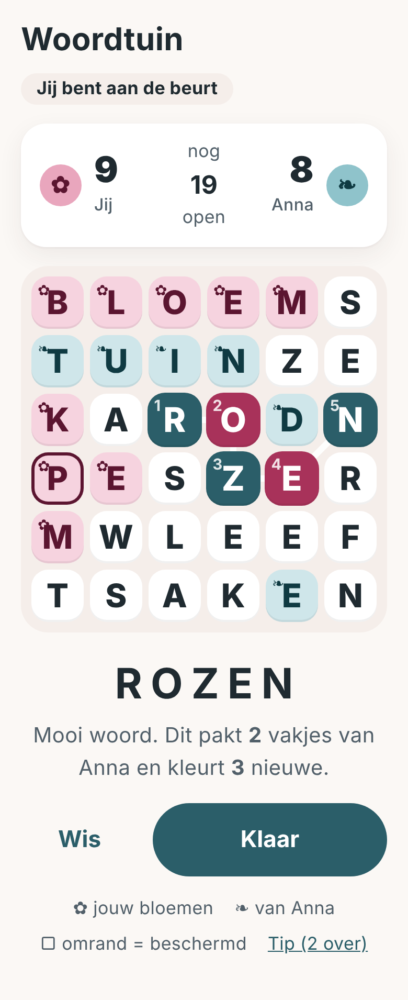

# Een spel voor twee, met beurten

**Opdracht:** een écht goed spel om met een vriend(in) te spelen, om beurten en ook als jullie niet tegelijk online zijn, in de
klasse van Wordfeud, maar niet hetzelfde. Zo'n spel moet je na een jaar nog steeds willen openen om te zien of de ander een zet heeft gedaan.

**Voorstel: Woordtuin.** Een bord met 6×6 letters. Om beurten maak je een woord door aangrenzende letters aan te tikken (net als bij
de Woordzoeker). De letters van je woord worden **jouw bloemen**. Maakt de ander later een woord dat door jouw letters loopt, dan pakt
die ze af, tenzij ze beschermd zijn. Als alle vakjes gekleurd zijn, wint wie de meeste bloemen heeft.

([`woordtuin-schets.html`](woordtuin-schets.html) is dezelfde schets als pagina.)

## Hoe ik hier gekomen ben (en waarom niet het eerste idee)

Ik heb niet alleen nagedacht maar de regels laten **simuleren**: bots spelen duizenden partijen tegen elkaar op een
echte Nederlandse woordenlijst (de scripts staan in [`tools/proto/`](../tools/proto/README.md)). Een spel is pas goed als
*slimmer spelen loont*, *de beginner niet wint*, *een achterstand te winnen is* en *het niet eeuwig duurt*. Dat bleek lastiger dan gedacht:

| Ontwerp | Wat de metingen lieten zien | Oordeel |
|---|---|---|
| **Kruisduel** (mijn eerste voorstel, daarna uitgewerkt met een rek letters en een gedeelde zak) | Wie meer woorden kent wint 68–76 %. Slimmer spelen met gelijke kennis maakt bijna niets uit (49–51 %). De leider wisselt bijna nooit (0,03–0,08 keer per partij). Ruim de helft van de punten komt uit bonussen. | Een kennisquiz, geen strategiespel. **Laat ik vallen.** |
| Letters die verdwijnen en naar beneden vallen (Boggle-achtig) | De beginner wint 95–98 %: het eerste lange woord beslist. | Mislukt |
| Idem, met aanvullen en vast aantal beurten | Eerlijk (50/50), maar er is geen interactie: er zijn ±600 woorden mogelijk, dus je kunt de ander niets afnemen. Een vocabulairewedstrijd. | Te vlak |
| **Woordtuin** met vakjes veroveren | Zie hieronder | **Dit is het** |

Les: diepgang komt niet van meer regels maar van **schaarste en gevolgen**. Wat jij speelt verandert wat de ander kan.
Bij Wordfeud zijn dat de bonusvakjes en je rek; bij Woordtuin zijn dat de vakjes zelf.

## De regels

1. **Bord.** 6×6 letters volgens de Nederlandse letterverdeling, bij het begin gecontroleerd (genoeg woorden, geen onspeelbaar bord).
2. **Je beurt.** Tik of veeg een woord van 3 tot 7 letters over aangrenzende vakjes (ook schuin, elk vakje maar één keer per woord).
   Het woord moet in de woordenlijst staan en mag in deze partij nog niet gespeeld zijn, door niemand.
3. **Kleuren.** De vakjes van je woord worden van jou. Behalve **beschermde** vakjes: een vakje dat aan alle kanten (links, rechts,
   boven, onder) grenst aan vakjes van dezelfde kleur. Vakjes aan de rand of in de hoek zijn dus makkelijker te beschermen.
4. **Elk woord moet minstens één open vakje kleuren.** Dit is de regel die het spel eindigt (zie de metingen: zonder deze regel
   duurt een partij op het 5×5-bord 48 zetten per speler, met deze regel op 6×6 ongeveer 10).
5. **Einde.** Zijn alle vakjes gekleurd? Dan wint wie de meeste heeft. Bij gelijkspel de meeste beschermde vakjes, daarna gelijkspel.
   Kan iemand niet meer, dan wordt de beurt overgeslagen; kan niemand meer, dan is het afgelopen.
6. **Nooit straf.** Een woord dat niet bestaat wordt vriendelijk geweigerd ("Dit woord kennen we niet, probeer een ander"). Geen tijdslimiet, geen levens.

Eén regel erbij die strategie geeft: **elk woord kan maar één keer worden gespeeld.** Een mooi lang woord pakken is dus ook je tegenstander een woord afnemen.

## Waarom dit werkt (gemeten, 6×6, 300 partijen per rij)

| Vraag | Uitkomst |
|---|---|
| Hoe lang duurt een partij? | ongeveer **10 zetten per speler**, vergelijkbaar met Wordfeud |
| Loont slimmer spelen? | een bot die **één zet vooruitkijkt** wint **73 %** van een gretige bot (18 % verlies, rest gelijk) |
| Loont meer woorden zien? | een speler die 30 % van de mogelijke woorden ziet wint 67 % van een die er 15 % ziet |
| Heeft de beginner voordeel? | gelijk spelende bots: 42 % tegen 48 % winst, 10 % gelijkspel; van de beslissende partijen wint de beginner 56 % |
| Is een achterstand te winnen? | de leider wisselt gemiddeld **7 à 9 keer per partij**; wie na twee derde voorstaat, wint maar 62–69 % |
| Hoeveel keuze heb je? | gemiddeld **±570 mogelijke woorden** aan het begin van een partij |

Dus: vaardigheid telt zwaar mee, maar één slechte zet beslist niet, en tot de laatste zet kan het omslaan. Dat is precies wat je
van een spel wilt dat je blijft spelen.

**Kanttekeningen, eerlijk:** bots zijn geen mensen. Echte spelers kijken minder ver vooruit en kennen andere woorden, dus *deze getallen zijn een
richting, geen garantie*. De drie dingen die ik met echte spelers wil testen voordat ik ze vastleg: **5×5 of 6×6**, of **"minstens één open vakje"** prettig voelt, en de
**gelijkspelregel** (10 % gelijk is veel; de beschermde vakjes lossen het meestal op).

## Hoe het spelen voelt

- **Strategie die je meteen snapt.** Woorden langs de rand zijn veilig; een woord door het midden is groot maar kwetsbaar. De laatste open vakjes
  zijn "heet": wie ze neemt, kan het spel beslissen. Eén lang woord dat je neemt, kan de ander net de zet ontnemen.
- **Je ziet wat je doet.** Terwijl je een woord maakt, lichten de vakjes op die je zou pakken, en staat er "Dit pakt 2 vakjes van Anna en kleurt 3 nieuwe." Pas daarna druk je op **Klaar**. Geen misklikken, geen spijt.
- **Gewoon mooi.** Een gepakt vakje bloeit open in jouw kleur (we hebben de bloesemanimatie al). Beschermde vakjes krijgen een rand.
- **Voor iedereen.** Kleur én symbool (✿ jij, ❧ de ander), grote vakjes, hardop voorgelezen door schermlezers. Wie niet kan vegen, **typt het woord** en de app laat zien waar het ligt. Geen timer.
- **Samen op een eerlijke manier.** In een *vriendelijke partij* krijgt de zwakkere speler **tips** ("er zit een woord met een Z in de rechterhoek"). Opa kan zo toch van zijn kleinkind winnen, of omgekeerd.
- **Nooit wachten op een vriend.** Er komt een **computertegenstander** in drie sterktes (dezelfde bot als in de metingen), zodat je altijd kunt spelen en de regels kunt leren.
- **Een eigen stand.** Onder elke vriend: "Jullie staan 3–2." Geen ranglijst met vreemden.

## Wat het kost om te bouwen

| Stap | Wat |
|---|---|
| 1. Woordenlijst | OpenTaal (Stichting OpenTaal, Keurmerk Spelling), **BSD of CC BY 3.0, dus vrij te gebruiken met vermelding** (komt in *Hulp*). Gefilterd op a–z, 3–7 letters: **±39.000 woorden, ±100 kB ingepakt**. Het is dus ook geschikt voor op de telefoon (voor de computertegenstander en tips). |
| 2. Regels (`js/games/woordtuin/engine.js`) | Eén module voor client én server: bord maken, woord controleren, kleuren, beschermen, einde. Met tests, onder andere een balanstest die de metingen hierboven herhaalt zodat een regelwijziging nooit ongemerkt het spel kapotmaakt. |
| 3. Server (`server/games/woordtuin.mjs`) | Past in het bestaande beurtsysteem (`docs/ACCOUNTS.md`): `create` en `apply`. Er is geen geheim (iedereen ziet alles), dus eenvoudiger dan een spel met een verborgen rek. |
| 4. Computertegenstander en tips | Zoeken van alle woorden op het bord (boom met voorvoegsels), kiezen volgens de sterkte. Het prototype doet dit al. |
| 5. Scherm (`js/views/woordtuin.js`) | Bord, woord maken (vegen, tikken of typen), voorvertoning, stand, partijenlijst onder *Vrienden*, uitslagscherm met bloesem. |
| 6. Afronden | Uitleg in *Hulp*, proefpartij tegen de computer, speltest met echte mensen, bijstellen. |

**Risico's:** (1) de woordenlijst bevat ook rare vormen en namen (mijn bots speelden "naoogde"); voor tips en de computer neem ik alleen gangbare woorden, voor spelers accepteer ik veel, en er komt een lijst met woorden die we weigeren. (2) Zonder woordfrequenties kunnen we niet
nauwkeurig bepalen wat "gangbaar" is; dat is een opzoekklus. (3) Spelers vinden soms een woord dat niet in de lijst staat: er komt een knop "Dit woord zou moeten kunnen" die het naar ons stuurt, en we bepalen de uitkomst.

## Ander spelideeën (kort, voor later)

Deze zijn in dezelfde klasse als wat ik eerst voorstelde, dus lichter dan Woordtuin. Allemaal draaien ze op hetzelfde beurtsysteem.

| Spel | Idee in één zin | Bouwen |
|---|---|---|
| **Samen puzzelen** | Jullie lossen één Sudoku, woordzoeker of kruiswoord *samen* op, om beurten, zonder winnaar | klein |
| **Geheugenduel** | Open om beurten twee kaartjes met bloemen en dieren | klein |
| **Domino** | Het bekende stenenspel met verborgen stenen | middel |
| **Bloeihokjes** | "Puntjes en hokjes" in een bloementuin | klein |
| **Raadduel** | Eén verborgen woord van 5 letters, jullie raden om beurten | klein |

*Samen puzzelen* is de moeite waard als tweede: het is geen nieuw spel maar een manier van spelen die voor alle bestaande spellen geldt, zonder wedstrijd, ideaal voor opa en kleinkind.
