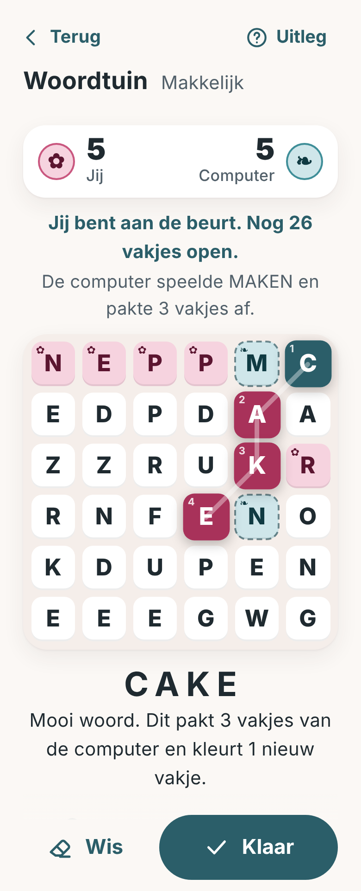

# Een spel voor twee, met beurten

**Opdracht:** een écht goed spel om met een vriend(in) te spelen, om beurten en ook als jullie niet tegelijk online zijn, in de
klasse van Wordfeud, maar niet hetzelfde. Zo'n spel moet je na een jaar nog steeds willen openen om te zien of de ander een zet heeft gedaan.

**Woordtuin** is dit spel, en het is gebouwd. Een bord met 6×6 letters. Om beurten maak je een woord door aangrenzende letters aan
te tikken of eroverheen te vegen (net als bij de Woordzoeker). De letters van je woord worden **jouw bloemen**. Maakt de ander later een woord
dat door jouw letters loopt, dan pakt die ze af, tenzij ze beschermd zijn. Als alle vakjes gekleurd zijn, wint wie de meeste bloemen heeft.

**Status:** speelbaar tegen de computer (vier niveaus, ook zonder account) en tegen een vriend via de server (om beurten, ook als jullie
niet tegelijk online zijn). Zie onderaan wat er nog moet.

## Hoe ik hier gekomen ben (en waarom niet het eerste idee)

Ik heb niet alleen nagedacht maar de regels laten **simuleren**: bots spelen duizenden partijen tegen elkaar op een
echte Nederlandse woordenlijst (de scripts staan in [`tools/proto/`](../tools/proto/README.md)). Een spel is pas goed als
*slimmer spelen loont*, *de beginner niet wint*, *een achterstand te winnen is* en *het niet eeuwig duurt*. Dat bleek lastiger dan gedacht:

| Ontwerp | Wat de metingen lieten zien | Oordeel |
|---|---|---|
| **Kruisduel** (mijn eerste voorstel, daarna uitgewerkt met een rek letters en een gedeelde zak) | Wie meer woorden kent wint 68–76 %. Slimmer spelen met gelijke kennis maakt bijna niets uit (49–51 %). De leider wisselt bijna nooit (0,03–0,08 keer per partij). Ruim de helft van de punten komt uit bonussen. | Een kennisquiz, geen strategiespel. **Laat ik vallen.** |
| Letters die verdwijnen en naar beneden vallen (Boggle-achtig) | De beginner wint 95–98 %: het eerste lange woord beslist. | Mislukt |
| Idem, met aanvullen en vast aantal beurten | Eerlijk (50/50), maar er is geen interactie: er zijn ±600 woorden mogelijk, dus je kunt de ander niets afnemen. Een vocabulairewedstrijd. | Te vlak |
| **Woordtuin** met vakjes veroveren | Zie hieronder | **Dit is het** |

Les: diepgang komt niet van meer regels maar van **schaarste en gevolgen**. Wat jij speelt verandert wat de ander kan.
Bij Wordfeud zijn dat de bonusvakjes en je rek; bij Woordtuin zijn dat de vakjes zelf.

## De regels

1. **Bord.** 6×6 letters volgens de Nederlandse letterverdeling, bij het begin gecontroleerd (genoeg woorden, geen onspeelbaar bord).
2. **Je beurt.** Tik of veeg een woord van 3 tot 7 letters over aangrenzende vakjes (ook schuin, elk vakje maar één keer per woord).
   Het woord moet in de woordenlijst staan en mag in deze partij nog niet gespeeld zijn, door niemand.
3. **Kleuren.** De vakjes van je woord worden van jou. Behalve **beschermde** vakjes: een vakje dat aan alle kanten (links, rechts,
   boven, onder) grenst aan vakjes van dezelfde kleur. Vakjes aan de rand of in de hoek zijn dus makkelijker te beschermen.
4. **Elk woord moet minstens één open vakje kleuren.** Dit is de regel die het spel eindigt (zie de metingen: zonder deze regel
   duurt een partij op het 5×5-bord 48 zetten per speler, met deze regel op 6×6 ongeveer 10).
5. **Einde.** Zijn alle vakjes gekleurd? Dan wint wie de meeste heeft. Bij gelijkspel de meeste beschermde vakjes, daarna gelijkspel.
   Kan iemand niet meer, dan wordt de beurt overgeslagen; kan niemand meer, dan is het afgelopen.
6. **Nooit straf.** Een woord dat niet bestaat wordt vriendelijk geweigerd ("Dit woord kennen we niet, probeer een ander"). Geen tijdslimiet, geen levens.

Eén regel erbij die strategie geeft: **elk woord kan maar één keer worden gespeeld.** Een mooi lang woord pakken is dus ook je tegenstander een woord afnemen.

## Waarom dit werkt (eerste meting, 6×6, 300 partijen per rij, met de volledige woordenlijst)

| Vraag | Uitkomst |
|---|---|
| Hoe lang duurt een partij? | ongeveer **10 zetten per speler**, vergelijkbaar met Wordfeud |
| Loont slimmer spelen? | een bot die **één zet vooruitkijkt** wint **73 %** van een gretige bot (18 % verlies, rest gelijk) |
| Loont meer woorden zien? | een speler die 30 % van de mogelijke woorden ziet wint 67 % van een die er 15 % ziet |
| Heeft de beginner voordeel? | gelijk spelende bots: 42 % tegen 48 % winst, 10 % gelijkspel; van de beslissende partijen wint de beginner 56 % |
| Is een achterstand te winnen? | de leider wisselt gemiddeld **7 à 9 keer per partij**; wie na twee derde voorstaat, wint maar 62–69 % |
| Hoeveel keuze heb je? | gemiddeld **±570 mogelijke woorden** aan het begin van een partij |

Dus: vaardigheid telt zwaar mee, maar één slechte zet beslist niet, en tot de laatste zet kan het omslaan. Dat is precies wat je
van een spel wilt dat je blijft spelen.

**Kanttekening, eerlijk:** bots zijn geen mensen. Echte spelers kijken minder ver vooruit en kennen andere woorden, dus *deze getallen zijn een
richting, geen garantie* (wat er nog met echte spelers getest moet worden staat onderaan).

## Hoe het spelen voelt

- **Strategie die je meteen snapt.** Woorden langs de rand zijn veilig; een woord door het midden is groot maar kwetsbaar. De laatste open vakjes
  zijn "heet": wie ze neemt, kan het spel beslissen. Eén lang woord dat je neemt, kan de ander net de zet ontnemen.
- **Je ziet wat je doet.** Terwijl je een woord maakt, lichten de vakjes op die je zou pakken, en staat er "Dit pakt 2 vakjes van Anna en kleurt 3 nieuwe." Pas daarna druk je op **Klaar**. Geen misklikken, geen spijt.
- **Gewoon mooi.** Een gepakt vakje bloeit open in jouw kleur (we hebben de bloesemanimatie al). Beschermde vakjes krijgen een rand.
- **Voor iedereen.** Kleur én symbool (✿ jij, ❧ de ander), grote vakjes, hardop voorgelezen door schermlezers. Wie niet kan vegen, **typt het woord** en de app laat zien waar het ligt. Geen timer.
- **Samen op een eerlijke manier.** In een *vriendelijke partij* heeft ieder **3 tips**: het beginvakje van een woord licht op, met het aantal letters. Opa kan zo toch van zijn kleinkind winnen, of omgekeerd.
- **Nooit wachten op een vriend.** Er is een **computertegenstander** in vier sterktes (dezelfde bot als in de metingen), zodat je altijd kunt spelen en de regels kunt leren.
- **Een eigen stand.** Onder elke vriend: "Jullie staan 3–2." Geen ranglijst met vreemden.

## De woordenlijst: alleen gewone stamwoorden

Een woordspel staat of valt met zijn woordenlijst. Mijn eerste lijst (de hele OpenTaal-lijst) liet het bord vol rare woorden toe ("naoogde",
"vimmen", "ropij"), dus het is nu veel strenger:

- **Alleen stamwoorden**: de gewone woordenboekvorm. "roos" mag, "rozen" (meervoud), "liep" (verleden tijd), "gebouwd" (deelwoord),
  "bokje" (verkleinwoord) en "sterke" (buiging) niet. Bij een poging krijg je een vriendelijke uitleg ("rozen is een andere vorm van roos").
- **Alleen woorden die bijna iedereen kent**: uit de OpenTaal-basislijst (Stichting OpenTaal, BSD / CC BY 3.0) vielen eerst alle zeldzame woorden af
  (frequentie in ondertitels), daarna heb ik de ±5.500 overgebleven woorden **één voor één beoordeeld**. Eruit: meervouden, verleden tijd, deelwoorden,
  namen, scheldwoorden, afkortingen, Engelse en andere vreemde woorden en alles wat een gemiddelde volwassene niet kent. Over: **±3.600 woorden**
  van 3 tot 7 letters.
- De beoordeling staat in `tools/woordtuin/blokkeerlijst.txt` (met grondwoord erbij, zo komt de uitleg tot stand) en kun je met de hand aanpassen:
  zet een woord op de blokkeerlijst of op `toegestaan.txt` en draai `node tools/make-woordtuin-lijst.mjs <map met bronbestanden>`
  (zie het begin van dat bestand voor de bronnen). Dat maakt `js/games/woordtuin/woorden.js` (±30 kB).

Dat maakt het bord wel *overzichtelijker*: een bord heeft nu gemiddeld ±180 mogelijke woorden (de goede borden), tegen 570 met de volledige lijst.
Opnieuw gemeten met deze lijst (6×6, 200 partijen per rij, bots):

| Vraag | Uitkomst |
|---|---|
| Hoe lang duurt een partij? | ±9,5 zetten per speler |
| Loont slimmer spelen? | een bot die één zet vooruitkijkt wint 67 % van een gretige bot (23 % verlies) |
| Loont meer woorden zien? | wie 30 % van de woorden ziet wint 62 % van wie er 15 % ziet |
| Heeft de beginner voordeel? | 53–58 % van de beslissende partijen |
| Is een achterstand te winnen? | de leider wisselt 5 à 7 keer per partij; wie na twee derde voorstaat, wint 62–66 % |

Dus ook met de strenge lijst blijft het spel diep, eerlijk en spannend. Een kleine versie van deze meting staat als test in
`tests/woordtuin.test.mjs`, zodat een regelwijziging het spel nooit ongemerkt kapot maakt.

## Zo is het gebouwd

| Onderdeel | Waar |
|---|---|
| Spelregels (één module voor de app én de server) | `js/games/woordtuin/engine.js` |
| Woordenlijst (gegenereerd) en het script dat hem maakt | `js/games/woordtuin/woorden.js`, `tools/make-woordtuin-lijst.mjs`, `tools/woordtuin/` |
| Bord (vegen, tikken, toetsenbord) en scherm (stand, woord, knoppen, typen, tip) | `js/games/woordtuin/bord.js`, `paneel.js`, `css/games/woordtuin.css` |
| Tegen de computer (niveaus makkelijk tot extreem, "Zet terug", tips) | `js/games/woordtuin/woordtuin.js` |
| Tegen een vriend: de server | `server/games/woordtuin.mjs` (past in het beurtsysteem van `docs/ACCOUNTS.md`) |
| Tegen een vriend: de schermen | `js/views/partij.js`, partijenlijst onder *Vrienden*, melding "… wacht op jou" op Start |
| Tests | `tests/woordtuin.test.mjs` (regels, woordenlijst, computer, balans), `tests/woordtuin-server.test.mjs` (een hele partij via de server) |

Hoe het voelt, zoals bedoeld: je ziet vooraf wat je woord oplevert ("Dit pakt 2 vakjes van Anna en kleurt 3 nieuwe") en pas daarna druk je op
**Klaar**; een woord dat niet bestaat kost niets en krijgt een uitleg; jouw bloemen zijn roze met een ✿ en die van de ander blauwgroen met een ❧
(kleur én symbool); wie niet kan vegen, typt het woord en de app laat zien waar het ligt; in een *vriendelijke partij* heeft ieder 3 tips.

**Wat er nog moet:**
- Meldingen als de app dicht is (web push). Nu zie je alleen in de app een cijfer bij *Vrienden*.
- Speltesten met echte mensen: **5×5 of 6×6**, of "minstens één open vakje" prettig voelt, en de gelijkspelregel (bij gelijk aantal gaven de beschermde vakjes de doorslag).
- Een knop "Dit woord zou moeten kunnen" om woorden te melden die we missen; de lijst groeit dan met wat spelers echt tegenkomen.
- Meer woorden: de lijst is bewust streng. Komt er te vaak een woord niet door, zet het dan op `toegestaan.txt`.

## Ander spelideeën (kort, voor later)

Deze zijn in dezelfde klasse als wat ik eerst voorstelde, dus lichter dan Woordtuin. Allemaal draaien ze op hetzelfde beurtsysteem.

| Spel | Idee in één zin | Bouwen |
|---|---|---|
| **Samen puzzelen** | Jullie lossen één Sudoku, woordzoeker of kruiswoord *samen* op, om beurten, zonder winnaar | klein |
| **Geheugenduel** | Open om beurten twee kaartjes met bloemen en dieren | klein |
| **Domino** | Het bekende stenenspel met verborgen stenen | middel |
| **Bloeihokjes** | "Puntjes en hokjes" in een bloementuin | klein |
| **Raadduel** | Eén verborgen woord van 5 letters, jullie raden om beurten | klein |

*Samen puzzelen* is de moeite waard als tweede: het is geen nieuw spel maar een manier van spelen die voor alle bestaande spellen geldt, zonder wedstrijd, ideaal voor opa en kleinkind.
